# PlacidWay website knowledge chatbot

A source-grounded chatbot for the AI Automation Engineer assessment. It answers from the seven approved PlacidWay pages, cites its sources, and offers a free quote when the pages cannot answer. Prices come from audited structured records rather than generated numbers.

## Start with Docker Compose

Requirements: Docker Engine/Desktop with Compose, Python 3 for the one-time configuration bootstrap, network access to the seven source URLs, Hugging Face on the first embedding-model download, and the configured generation provider. Python 3.12 with uv and Bun are needed for host development.

```sh
cd placidway-assesment
python3 scripts/bootstrap_env.py
# Edit .env locally; never commit it.
docker compose up --build -d
```

Open **http://localhost:8080**. Initial ingestion takes a few minutes: the crawler respects the website's observed 10-second crawl delay and downloads the embedding model once. The UI shows knowledge readiness. Check startup with `docker compose ps` and `docker compose logs --tail=60 refresh`.

The bootstrap script preserves supplied settings from the parent `.env` and creates two independent random login secrets. Use `AUTH_OWNER_SECRET` for your owner session or `AUTH_CLIENT_SECRET` for the PlacidWay reviewer session. Login has a single secret field. The owner can refresh content; the client cannot see the owner's conversations. Secrets are stored only in the ignored `.env`, with file mode 0600. Rotating a login secret and restarting the API revokes that account's previous sessions.

Set these provider settings in `.env`:

| Variables | Purpose |
| --- | --- |
| `OPENAI_BASE_URL`, `OPENAI_MODEL`, `OPENAI_API_KEY` | Your OpenAI-compatible Chat Completions endpoint for Bedrock GPT-OSS 120B |
| `OPENAI_REASONING_EFFORT=low` | Generation reasoning budget; output is validated JSON |
| `OPENROUTER_BASE_URL`, `OPENROUTER_MODEL`, `OPENROUTER_API_KEY` | Offline decision judge, using the user-tested `/systemone` API |
| `RETRIEVAL_MODE` | `dense`, `bm25`, or `hybrid`; see measured results in docs |
| `PORT=8080` | Frontend host port |
| `COOKIE_SECURE=false` | Set `true` when serving the app over HTTPS |
| `POSTGRES_PASSWORD` | Optional database password override for Compose |

The judge is unnecessary for chatting. There is no LangSmith or Confident AI upload. `.env.example` contains configuration names without credentials. Never expose provider keys to the frontend.

## How it works

```mermaid
flowchart LR
  Pages[Seven allowlisted pages] --> Extract[Robots-aware extraction]
  Extract --> Facts[Versioned price facts]
  Extract --> Chunks[MiniLM chunks and vectors]
  Facts --> PG[(PostgreSQL + pgvector)]
  Chunks --> PG
  UI[React / Bun UI] --> API[FastAPI + session auth]
  API --> Resolve[Resolve intent and follow-up]
  Resolve --> Retrieve[Dense / BM25 / hybrid retrieval]
  PG --> Retrieve
  Retrieve --> Coverage[Check coverage / one broader pass]
  Coverage --> Draft[Structured factual draft]
  Draft --> Validate[Price, citation and support checks]
  Validate --> Checkpoint[PostgreSQL LangGraph checkpoint]
  Checkpoint --> SSE[Durable SSE replay]
  SSE --> UI
```



The backend uses explicit LangGraph nodes with LangChain's `ChatOpenAI` client. Retrieval is English; responses support English, Spanish, and Arabic, including RTL layout. Only the last eight conversation messages enter the resolver, while the full transcript remains persisted.

Content is ingested in advance and refreshed daily or by the owner. No arbitrary live browsing runs during chat. All seven pages must validate before a new corpus becomes active; a failed refresh preserves the previous corpus. Unchanged pages reuse their stored chunks and embeddings. Each answer pins a single corpus version.

High-risk prices use `Decimal` records tied to treatment, country, programme, qualifiers, units and source evidence. Exact price lookups select records; the server renders their amounts. Every factual candidate passes a separate support verifier. Missing recovery time is never inferred from the three-week treatment duration. A comparison cannot establish a cheaper option without compatible evidence for both sides.

Progress stages stream immediately. The answer itself is buffered until validation and checkpointing finish, then delivered as SSE deltas. This is validated answer streaming, not raw model-token streaming. The collapsed activity panel contains operational summaries; private model reasoning is removed and never displayed. Hybrid retrieval is the delivered default after the measured comparison; dense remains the baseline and all modes can be selected through configuration.

## Development

```sh
cd apps/agent
uv sync --extra eval
uv run placidway migrate
uv run placidway provider-check
uv run placidway refresh
uv run placidway serve --host 127.0.0.1
```

For host development, set `DATABASE_URL` to a reachable PostgreSQL database with pgvector. Compose's database is internal by default. Run frontend commands in another terminal:

```sh
cd apps/web
bun install --frozen-lockfile
bun run dev
```

Vite serves port 5173 and proxies `/api` to port 8000. The production frontend uses Nginx and same-origin API requests. Linux containers install CPU-only PyTorch; no GPU is required.

## Verify and evaluate locally

```sh
cd apps/agent
uv run ruff check src tests
uv run pytest -q
RUN_DB_TESTS=1 uv run pytest tests/test_api_integration.py -q
RUN_DB_TESTS=1 uv run pytest tests/test_refresh_integration.py -q
uv run placidway compare-retrieval
uv run placidway calibrate-judge
uv run placidway evaluate --split dev --mode hybrid
uv run placidway evaluate-conversations --split dev --mode hybrid
RUN_LIVE_EVALS=1 EVAL_SPLIT=all RETRIEVAL_MODE=hybrid uv run deepeval test run tests/evals/test_single_turn.py
RUN_LIVE_EVALS=1 EVAL_SPLIT=all RETRIEVAL_MODE=hybrid uv run deepeval test run tests/evals/test_conversation.py
```

Provider-backed commands use your configured API access. Normal pytest skips live suites and the database integration test unless opted in. There are 60 source-labelled single-turn cases (40 development, 20 held-out), 12 conversations (8 development, 4 held-out), and eight separate judge calibration fixtures. Labels are **AI-curated and source-verified**, not human-labelled. They are frozen against content hashes; evaluation stops if the active corpus has changed. Audit source changes before regenerating labels with `uv run python ../../scripts/build_eval_dataset.py`.

Reports, evidence, scores, usage and failures stay under `reports/`. The custom DeepEval metrics call the typed decision endpoint directly; this model does not masquerade as a text-generating judge. A wrong price record or outcome fails independently of the judge. The 0.8 threshold is fixed and matching calibration is required before live evaluation. Reports fingerprint the code, prompts, corpus, extractor, embedding model and rubric. Historical failures are retained. Ten improvement rounds are already recorded; subsequent audit runs are verification. Retrieval metrics use stable evidence identities at ranks 3 and 5, with duplicate chunks receiving no extra gain. The current family-disjoint split is a regression split: all cases have been inspected previously, so it is not an independent holdout.

```sh
cd apps/web
bun run typecheck
bun run test:smoke
bun run test:mobile
bun run build
# Against the Compose app, using the ignored .env login secret:
PLAYWRIGHT_BASE_URL=http://localhost:8080 bun run test:live
```

Browser tests use installed Google Chrome (`channel: 'chrome'` in the Playwright configs).

Compose also has an optional evaluation image: `docker compose --profile eval run --build --rm evals evaluate --split dev --mode hybrid`. Evaluation dependencies are excluded from the production image.

## Operations and handoff

- [Detailed approved specification](docs/implementation-spec.md)
- [Review against the original contract](docs/contract-audit.md)
- [API and streaming contract](docs/chat-api.md)
- [Deployment, refresh, backup and recovery](docs/operations.md)
- [Evaluation findings and required assessment answers](docs/evaluation.md)
- [Actual answers to all eight assessment questions](docs/assessment-answers.md)
- [Known limitations and next-week improvements](docs/limitations.md)

The application is runnable locally with Compose. Public hosting and DNS belong to the user; a public submission URL must still be provisioned and kept available for at least seven days. No email, repository publication, or external deployment is performed automatically.
