# PlacidWay website knowledge chatbot

A chatbot for the AI Automation Engineer assessment that answers from the seven approved PlacidWay pages. It cites supporting URLs, preserves price currency and programme context, and offers a quote link when information is missing. The interface supports English, Spanish and Arabic, conversation history and follow-up questions.

## Assessment submission

| Item | Where to find it |
| --- | --- |
| Setup, architecture and technology choices | This README |
| Answers to the eight assessment questions | [Recorded chatbot answers](docs/assessment-answers.md) |
| Known limitations and improvements with another week | [Half-page write-up](docs/limitations.md) |
| Evaluation method, results and remaining failures | [Evaluation summary](docs/evaluation.md) |
| Public demo | **Pending: add the deployed HTTPS URL before submission.** |

Public deployment and seven-day availability have not been verified in the recorded results. Before submission, provision the public URL, provide the reviewer login secret privately, and keep the application and generation provider available for at least seven days after submission.

## Run locally

Requirements: Docker with Compose, Python 3 for configuration bootstrap, and network access to the approved pages, Hugging Face for the initial embedding download, and your generation provider. Allow at least 4 GB RAM for the Compose deployment and build headroom; no GPU is required.

From the repository root:

```sh
python3 scripts/bootstrap_env.py
# Edit .env with your provider settings.
docker compose config --quiet
docker compose up --build -d
```

Open **http://localhost:8080**. The refresh worker performs initial ingestion; this can take a few minutes while it downloads the embedding model and observes the website's crawl delay. Check progress with `docker compose ps` and `docker compose logs --tail=60 api refresh`. The interface displays knowledge readiness.

The bootstrap script preserves existing repository settings, or imports the parent `.env` when creating the repository configuration. It fills missing configuration entries and generates separate `AUTH_OWNER_SECRET` and `AUTH_CLIENT_SECRET` values if absent. The resulting `.env` is ignored by Git and has mode `0600`. Enter the appropriate secret in the single-field login screen. The owner can refresh content; each account has its own history. People using the same account secret share that account's history.

| Configuration | Purpose |
| --- | --- |
| `OPENAI_BASE_URL`, `OPENAI_MODEL`, `OPENAI_API_KEY` | Required OpenAI-compatible Chat Completions provider; the recorded build used Bedrock GPT-OSS 120B (`openai.gpt-oss-120b-1:0`) |
| `OPENAI_REASONING_EFFORT=low` | Reasoning budget used in the recorded build |
| `OPENROUTER_BASE_URL`, `OPENROUTER_MODEL`, `OPENROUTER_API_KEY` | Offline evaluation judge; recorded model: `inception/mercury-decide:free` through `/systemone` |
| `RETRIEVAL_MODE=hybrid` | Default retrieval; `dense` and `bm25` are also available |
| `REFRESH_INTERVAL_SECONDS=86400` | Daily refresh interval |
| `PORT=8080`, `COOKIE_SECURE=false` | Local HTTP settings; use `COOKIE_SECURE=true` behind public HTTPS |
| `POSTGRES_PASSWORD` | Optional Compose database password override |

The judge is needed only for judge-backed evaluations. Chat uses the generation provider and local retrieval. Keep credentials in `.env`; the frontend receives no provider keys. The credential-free [.env.example](.env.example) lists the application settings.

## Architecture and design choices

```mermaid
flowchart LR
  Sources[Seven approved pages] --> Extract[Extract text and price facts]
  Extract --> DB[(PostgreSQL and pgvector)]
  UI[React chat interface] --> Resolve[Resolve question and history]
  Resolve --> Retrieve[Hybrid retrieval and price lookup]
  DB --> Retrieve
  Retrieve --> Coverage[Check evidence coverage]
  Coverage --> Draft[Structured answer]
  Draft --> Validate[Price, citation and support checks]
  Validate --> Persist[Checkpoint and durable SSE events]
  Persist --> UI
```



| Tool or model | Role and reason for choosing it |
| --- | --- |
| Python 3.12, uv and FastAPI | Typed backend with reproducible dependencies, HTTP endpoints and server-sent events |
| Beautiful Soup and HTTPX | Source-specific extraction that preserves tables and removes navigation, forms and unrelated recommendations |
| LangGraph and LangChain `ChatOpenAI` | Explicit, bounded workflow with persisted state and an OpenAI-compatible model client |
| GPT-OSS 120B | Resolves requests, checks coverage, drafts structured answers and verifies support; structured output allows validation before display |
| Local `all-MiniLM-L6-v2`, pgvector and `rank_bm25` | Small CPU embedding model and interchangeable dense, lexical and hybrid retrieval; hybrid was selected from the recorded comparison |
| PostgreSQL 17 | Stores source versions, decimal price facts, vectors, sessions, conversations, checkpoints and replayable events together |
| React, TypeScript, Vite, Bun, Tailwind and shadcn/ui primitives | Responsive chat interface with language selection, Arabic RTL, citations and recovery states |
| DeepEval and Mercury Decide | Offline deterministic checks plus a separate typed decision judge for grounding, completeness, scope and language |
| Docker Compose and Nginx | Reproducible local deployment with persistent volumes and a same-origin, unbuffered API proxy |

Ingestion follows only the allowlist in [sources.py](apps/agent/src/placidway/sources.py): the ITC clinic profile, three cancer treatment packages, clinic video listings, clinic price list and alternative-medicine price comparison. It identifies the crawler, respects `robots.txt`, and waits at least one second between requests or longer when required; the observed crawl delay was ten seconds. Video ingestion uses visible listing text only.

Text is chunked with MiniLM's tokenizer using a 220-word-piece budget and 32-piece prose overlap. Table rows retain their headers. Retrieval combines dense and BM25 ranks using reciprocal rank fusion, retrieves five initial child hits and expands their parent evidence. Structured price lookup runs alongside text retrieval. The graph can make one broader retrieval pass when evidence coverage is insufficient.

Prices are stored as `Decimal` facts associated with treatment, country, programme, qualifier, currency, duration or unit, and supporting evidence. The server renders selected records. Validation checks price associations, supported numbers and allowed citations, then uses a separate model call to verify factual support. Missing recovery time is not inferred from programme duration; a cheaper-country conclusion requires compatible evidence for both sides. Website claims and testimonials do not establish personal medical suitability.

Retrieval uses English queries; the selected response language is persisted as English, Spanish or Arabic. The resolver receives the last eight conversation messages while the full transcript remains stored. Progress stages stream immediately. Answer text is released as SSE deltas only after validation and checkpointing. The activity panel shows operational summaries.

## Refresh, persistence and public hosting

Content refresh runs at startup and daily. The owner can use the refresh control in the interface or run:

```sh
docker compose exec api uv run --no-sync placidway refresh
```

Refresh validates all seven sources before atomically publishing a corpus. Unchanged pages reuse chunks and embeddings; a failed refresh preserves the previous corpus. Each answer uses one corpus version throughout. Changed content must be audited against the frozen evaluation labels before those evaluations can run again.

For public hosting, use a persistent Linux host with Docker Compose, HTTPS and long-lived SSE support. Set `COOKIE_SECURE=true`, keep the database internal, and build images before reviewer traffic. The included Nginx proxy disables SSE buffering. Run a single API worker, as required by the application's in-process scheduling. `/api/health/live` checks process liveness and `/api/health/ready` checks configuration and corpus readiness; readiness does not test the external generation provider.

Named volumes retain PostgreSQL data, source snapshots and the embedding cache. `docker compose restart api web` preserves completed history; interrupted runs can be retried. Avoid `docker compose down -v` when retaining data. Back up the database and source snapshots, and keep `.env` protected separately. Disable host auto-suspend and monitor the public URL during the required seven-day review period.

## Development and checks

Host development requires Python 3.12, uv, Bun and a reachable PostgreSQL database with pgvector. Set `DATABASE_URL` in `.env`; the Compose database has no published host port by default.

```sh
cd apps/agent
uv sync --extra eval
uv run placidway migrate
uv run placidway refresh
uv run placidway serve --host 127.0.0.1
```

In another terminal, from the repository root:

```sh
cd apps/web
bun install --frozen-lockfile
bun run dev
```

Vite serves port 5173 and proxies `/api` to port 8000. Production uses the Bun-built frontend served by Nginx. Backend source is in `apps/agent/src/placidway/`; frontend source is in `apps/web/src/`.

For local checks, run `uv run ruff check src tests` and `uv run pytest -q` from `apps/agent/`, then `bun run typecheck`, `bun run test:smoke`, `bun run test:mobile` and `bun run build` from `apps/web/`. Browser suites require installed Google Chrome. Against the running Compose application, use `PLAYWRIGHT_BASE_URL=http://localhost:8080 bun run test:live`.

The [evaluation summary](docs/evaluation.md) provides database and provider-backed reproduction commands. The recorded strict results were **58/60 single-turn cases and 10/12 conversations**. All recorded deterministic gates passed, with four remaining judge-gate failures disclosed in that summary. These are regression results from AI-curated, source-verified labels; all current cases have previously been inspected.
